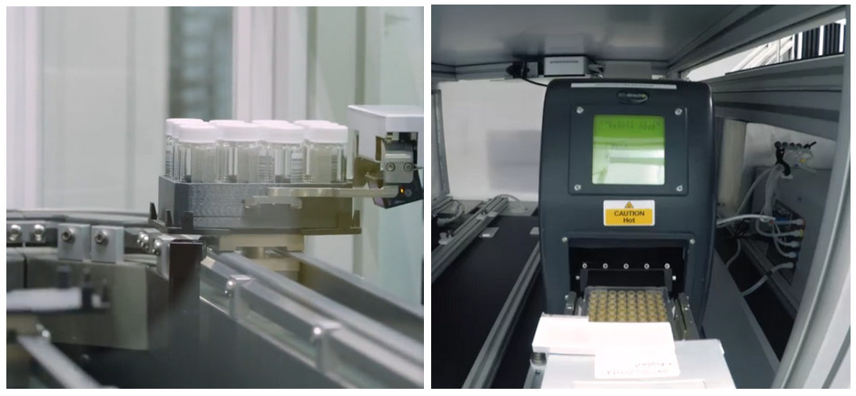
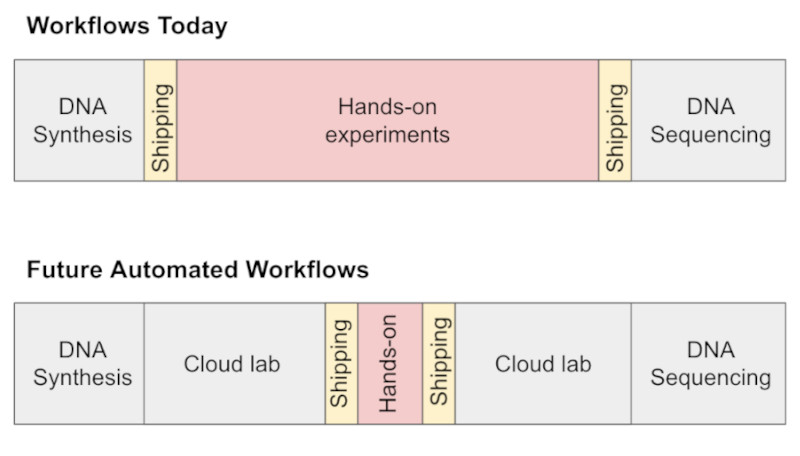

## What is a cloud lab?

Flexible laboratory resources, available on demand. The “cloud” references [cloud computing](https://en.wikipedia.org/wiki/Cloud_computing); cloud labs similarly allow users to perform work using hardware in a physically distant location, which is maintained by a different company or team. Regulation of cloud labs should address:

- General-purpose, highly-automated commercial lab facilities like those provided by [Emerald Cloud Lab](https://www.emeraldcloudlab.com/) (and, until [earlier this year](https://www.businesswire.com/news/home/20230418006219/en/Strateos-Announces-Strategic-Shift-to-Focus-on-Customer-Demand-for-On-Site-Cloud-Labs), [Strateos](https://strateos.com/)); model still commercially unproven
- Non-commercial facilities providing general-purpose lab automation, e.g. the members of the [Global Biofoundry Alliance](https://www.biofoundries.org/about), who are largely based at national and academic labs
- *(to a lesser degree)* Providers of specific high-throughput laboratory services to large numbers of clients, e.g. DNA [synthesis](https://genesynthesisconsortium.org/), DNA [sequencing](https://www.idtdna.com/pages/technology/next-generation-sequencing/dna-sequencing), microbial [fermentation](https://www.culturebiosciences.com/)

I’d distinguish companies with a small number of strong client relationships from cloud labs, even if they offer access to automation (e.g. [Ginkgo Bioworks](https://www.ginkgobioworks.com/), [Kebotix](https://www.kebotix.com/), some CROs). I’m not totally sure what’s going on with [self-driving labs](https://www.sciencedirect.com/science/article/pii/S0958166922002154) in biology.

## Why do people use cloud labs?

Well... they mostly don’t! Very few academics or companies currently make use of cloud labs or biofoundries. Automated laboratory equipment is expensive to buy, program, and maintain; as a result, few scientists have tested their protocols on this kind of hardware, making it risky to use even equipment maintained by others. We’re also still missing basic infrastructure for laboratory automation, like versions of simple protocols that don’t ask for manual actions.

If we had better infrastructure, cloud labs would be appealing for the following reasons:

1. High-throughput equipment coughs up the sorts of massive datasets that synergize well with emerging AI design tools
1. Automated experiments are more repeatable and reproducible, allowing scientists to catch smaller signals and more readily build on each other’s results
1. Sharing equipment allows more affordable access to a wider variety of instruments, as you don’t need to purchase or maintain the instruments yourself
1. On-demand equipment supports ebbs and flows in need for particular equipment types as projects change or companies scale

Given current trends in lab automation, I expect people will start using cloud labs more often; see more on this point under [What will cloud labs look like in the future?](#what-will-cloud-labs-look-like-in-the-future)

## What can cloud labs do right now?

Cloud labs, at present, do not allow researchers to do bioengineering without knowledge of biological protocols. They do:

- Allow scientists to use automated equipment without knowing how to maintain it
- Remove (some) tacit knowledge needed to use specialized equipment<a href="#fn1" id="fnref1">1</a>, and the tacit knowledge needed will keep decreasing as [LLMs get better at interpreting API docs](https://arxiv.org/abs/2304.05332)

{: .img-fluid}

Example of dozens of samples being moved around a cloud lab by robot arms ([source](https://strateos.com/virtual-lab-tour/)).
{: .caption}

Cloud labs are very early in the transition between “small number of client relationships” to “high-throughput service providers”. Getting started with them still looks more like “establish a client relationship” than “open an account and make an order” (contrast [IDT](https://www.idtdna.com/pages/technology/next-generation-sequencing/dna-sequencing), [Twist](https://www.twistbioscience.com/), [AddGene](https://www.addgene.org/)). That said, they’re more like high-throughput service providers than they were 3 years ago, and we should expect this trend to continue and accelerate (see [Bioautomation Challenge](https://alignbio.org/the-challenge)).

ECL has [a full list of their instrumentation](https://www.emeraldcloudlab.com/instrumentation/) online. The old Strateos [virtual lab tour](https://strateos.com/virtual-lab-tour/) might be of interest, but as of April 2023 they have [announced](https://www.businesswire.com/news/home/20230418006219/en/Strateos-Announces-Strategic-Shift-to-Focus-on-Customer-Demand-for-On-Site-Cloud-Labs) a “strategic shift to focus on customer demand for on-site cloud labs” (i.e. building private labs with workcells that can be controlled over the internet).

## What will cloud labs look like in the future?

I want to be clear that we may not have large commercial cloud labs in the future; it’s not clear that the model works from a business or science perspective.

I broadly agree with the takes in [Automation is coming to life science](https://erikaaldendeb.substack.com/p/automation-is-coming-to-life-science) *\[2026 ETA: and [Heuristics for Lab Robotics](https://www.owlposting.com/p/heuristics-for-lab-robotics-and-where)\]* — automation enables new kinds of experiments, owning and maintaining your own robots sucks, future workflows will look like more and more parts of the design-build-test-analyze cycle in the life sciences going the way of DNA synthesis and sequencing.

{: .img-fluid}

Diagram from [Automation is coming to life science](https://erikaaldendeb.substack.com/p/automation-is-coming-to-life-science) by Erika Alden DeBenedictis.
{: .caption}

My extremely seat-of-the-pants predictions for the next few years are something like:

- **2023.** Hype around high-throughput measurement (especially in protein design), [more datasets gathered](https://alignbio.org/the-tournament), experimentation converting [natural language to API calls via LLMs](https://arxiv.org/abs/2304.05332)
- **2024.** Measurement “microservices” at cloud labs and biofoundries, biofoundries appearing in more national bioeconomy strategies, more natural language protocols
- **2025.** “Microservices” for molecular biology methods, e.g. DNA assembly, at this point we may have a few winners in the integration / bioautomation control software space

I want to comment briefly on why we don’t *already* have highly-automated cloud labs. My main theory is that, until quite recently, no one had functional workcells that integrated multiple instruments. This was partly because device manufacturers were not designing for automation, and many instruments could only be controlled via GUIs on dedicated PCs. Some players in making integration more possible: [Artificial Suite](https://www.artificial.com/solutions/workflows/), [BioSero GreenButtonGo](https://biosero.com/), [Strateos Lodestar](https://strateos.com/lodestar-software/), [Automata LINQ](https://automata.tech/products/), [HighRes Biosolutions](https://highresbio.com/spectrumofsystems/), [The Morse Group](https://www.themorsegroup.com/automation/life-sciences/).

## What should biosecurity-oriented regulation address?

If you’re worried about biology being misused to do harm, it’s unclear whether increased use of cloud labs is a positive or negative thing. A few considerations:

- **Datasets**: Cloud labs accelerate the reproducible collection of large-scale biological data, creating more results like Alphafold2 and accelerating biodesign for good and ill
- **Equipment**: Without customer screening, cloud labs might allow bad actors to access equipment that they would find challenging to purchase or use
- **Deskilling**: Reducing the tacit knowledge needed to do biology is the main concern about cloud labs raised in the WHO [Emerging Technologies and Dual-Use](https://www.who.int/publications/i/item/9789240036161) Report
- **Auditing:** Record-keeping at cloud labs could make it easier to audit research (e.g. for a WHO investigation of an outbreak’s origins)
- **Centralization**: Cloud labs could lead to the physical steps of biological research being centralized in a smaller number of facilities, making it easier to enforce regulations
- **Biosafety**: Cloud labs physically separate lab work from scientific decision-making, and scientists may request work that is unsafe for people at the facility performing it
- **Pandemic response**: Cloud labs and biofoundries are generalist biomanufacturing resources that can provide [useful infrastructure for rapid pandemic response](https://www.nature.com/articles/s41467-022-28103-3#Sec1)

I think it’s pretty unlikely that we’ll have cloud lab facilities that are certified to handle pandemic pathogens in the next 5 years. We should be thinking about risk in terms of dual-use knowledge and data generation, not “turnkey lab” scenarios for viral engineering. If we turn from biology to chemistry, cloud labs are a more immediate concern. LLMs [are already approaching](https://arxiv.org/abs/2304.05332) the ability to convert “synthesize this toxin” to “here are the cloud lab API calls for that reaction series”.

One obvious thing for regulation to address is customer screening (e.g. to ensure that export-controlled equipment and software is not being used by people who aren’t authorized to use it), though my understanding is that, at least in [the DNA synthesis world](https://progress.institute/preventing-the-misuse-of-dna-synthesis/), customer screening is an expensive mess.

It’s possible that certain kinds of cloud lab protocols should also face some kind of security screening (similar to sequence-based screening in DNA synthesis). The most appropriate form of security screening will range from “none, please let people do science” to “require a justification for specific experiments of this kind”. It’s the “specific experiments” in the last sentence that gets tricky; you can’t really point to a general-purpose protocol and say that it’s inherently dangerous.

## Further Reading

(blog posts or short papers, semi-prioritized list)
{: .caption}

1. Erika Alden DeBenedictis: [Automation is coming to life science](https://erikaaldendeb.substack.com/p/automation-is-coming-to-life-science) (February 2022), [Language is not enough](https://erikaaldendeb.substack.com/p/language-is-not-enough) (April 2023)
1. Daniil A. Boiko, Robert MacKnight, Gabe Gomes. [Emergent autonomous scientific research capabilities of large language models](https://arxiv.org/abs/2304.05332) (April 2023)
1. Global Biofoundries Alliance (I recommend just scrolling their website, but you could also check out [Building a global alliance of biofoundries](https://www.nature.com/articles/s41467-019-10079-2#change-history) (May 2019) or [Pandemic preparedness: synthetic biology and publicly funded biofoundries can rapidly accelerate response time](https://www.nature.com/articles/s41467-022-28103-3) (January 2022)
1. Tessa Alexanian: [The Case for Modular Lab Automation](https://medium.com/@ZymergenTechBlog/the-case-for-modular-lab-automation-c34f214e1276) (October 2019)
1. *\[ETA 2026\]* I also wrote [Develop a Screening Framework Guidance for AI-Enabled Automated Labs](https://fas.org/publication/bio-x-ai-policy-recommendations/#alexanian) for the FAS AI x Bio Sprint in December 2023 and recommend Abhishaike Mahajan, [Heuristics for lab robotics, and where its future may go](https://www.owlposting.com/p/heuristics-for-lab-robotics-and-where) (February 2026)

---

1 Though even if you don’t need to know which buttons to press on the mass spec, you need to understand appropriate experimental settings — should you set the mass spec’s [IonSource to ESI or MALDI](https://www.emeraldcloudlab.com/helpfiles/experimentmassspectrometry)? I sure don’t know! [↑](#fnref1)
{: .caption}
